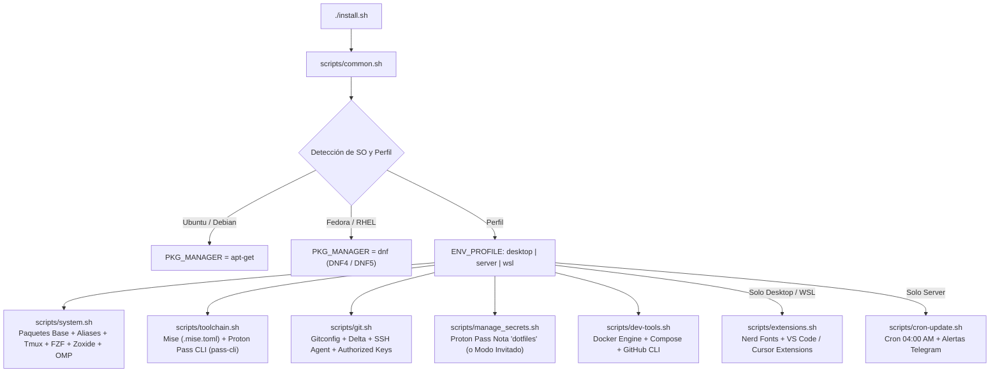

# 🚀 Dotfiles v3.0 — Web Dev & Cloud Server Platform

> **Tu entorno de desarrollo web y servidor Linux, 100% automatizado** — Configuración declarativa, idempotente y segura para **Ubuntu / Debian** y **Fedora / RHEL** (Server, Desktop Workstation y WSL), impulsada por **Mise** y **Proton Pass CLI**.

<!-- BADGES -->
[](https://www.gnu.org/software/bash/)
[](https://mise.jdx.dev/)
[](https://protonpass.github.io/pass-cli/)
[](https://ubuntu.com/)
[](https://fedoraproject.org/)
[](LICENSE)

<p align="center">
  
</p>

---

## 📑 Índice

- [🎯 ¿Qué es este proyecto?](#-qué-es-este-proyecto)
- [✨ Novedades v3.0](#-novedades-v30)
- [🏗️ Arquitectura Multi-Entorno (Server, Desktop y WSL)](#️-arquitectura-multi-entorno-server-desktop-y-wsl)
- [🚀 Guía de Instalación (Paso a Paso)](#-guía-de-instalación-paso-a-paso)
  - [🆕 Escenario 1: Distro Nueva SIN Credenciales (Guest Mode)](#-escenario-1-distro-nueva-sin-credenciales-guest-mode)
  - [🖥️ Escenario 2: Ubuntu Desktop / Fedora Workstation](#️-escenario-2-ubuntu-desktop--fedora-workstation)
  - [🖧 Escenario 3: Ubuntu Server / Fedora Server / Proxmox LXC](#-escenario-3-ubuntu-server--fedora-server--proxmox-lxc)
  - [🪟 Escenario 4: Windows + WSL2](#-escenario-4-windows--wsl2)
- [🎛️ Menú Interactivo v3.0 & Flags CLI](#️-menú-interactivo-v30--flags-cli)
- [🔐 Gestión de Secretos y SSH con Proton Pass CLI](#-gestión-de-secretos-y-ssh-con-proton-pass-cli)
- [📦 Toolchain Declarativo para Desarrollo Web (Mise)](#-toolchain-declarativo-para-desarrollo-web-mise)
- [⌨️ Referencia Completa de Aliases, Git y Tmux](#️-referencia-completa-de-aliases-git-y-tmux)
- [🧩 Gestión de Extensiones (VS Code / Cursor / VSCodium)](#-gestión-de-extensiones-vs-code--cursor--vscodium)
- [🔄 Actualizaciones Automáticas y Alertas Telegram (Cron)](#-actualizaciones-automáticas-y-alertas-telegram-cron)
- [🛠️ Guía de Desarrollo (Cómo Extender el Proyecto)](#️-guía-de-desarrollo-cómo-extender-el-proyecto)
- [🔁 Replicabilidad](#-replicabilidad)
- [🗑️ Desinstalación Total o Selectiva](#️-desinstalación-total-o-selectiva)
- [❓ FAQ y Troubleshooting](#-faq-y-troubleshooting)

---

## 🎯 ¿Qué es este proyecto?

**Dotfiles v3.0** es una plataforma de ingeniería de entorno personal que transforma cualquier instalación limpia de **Ubuntu/Debian** o **Fedora/RHEL** (ya sea un servidor headless en Proxmox/cloud, una estación de trabajo gráfica con Wayland/X11 o un contenedor WSL2) en un entorno profesional de desarrollo web e infraestructura en pocos minutos.

| Característica | Antes (v1) | v2.0 | **Ahora (v3.0)** |
| :--- | :--- | :--- | :--- |
| **Instalación** | Imperativa (Scripts manuales) | Declarativa (Mise) | **Perfiles Inteligentes (`Server` / `Desktop` / `WSL`)** |
| **Secretos** | Texto plano / Bitwarden CLI | Archivo `.env.age` en repo | **Proton Pass CLI (`pass-cli`) + `pass://` URIs** |
| **Distros** | Genérico (frágil en DNF5) | Multi-distro básico | **Ubuntu/Debian (`apt`) + Fedora (`dnf4`/`dnf5`) optimizado** |
| **Sin Credenciales** | Fallaba al clonar/instalar | Requería SSH/Passphrase | **Guest Mode nativo (instala todo sin pedir claves)** |
| **Interfaz (TUI)** | Menú básico | Menú numérico | **Dashboard en vivo + TUI interactivo con `gum` (flechas/espacio)** |

---

## ✨ Novedades v3.0

1. 🔐 **Proton Pass CLI (`pass-cli`) como única fuente de verdad**:
   - Eliminamos la dependencia de Vaultwarden/Bitwarden y de archivos `.env.age` versionados en el repositorio público.
   - Tus tokens (`GH_TOKEN`, `RCLONE_TOKEN_JSON`, `TELEGRAM_BOT_TOKEN`, `TELEGRAM_CHAT_ID`) y tus llaves SSH se consultan directamente desde tu bóveda de Proton Pass en la nota **`dotfiles`** (`pass://Personal/dotfiles`).
   - **Persistencia post-reinicio solucionada**: Configura automáticamente `PROTON_PASS_KEY_PROVIDER=fs` (respetando sesiones activas en keyring si existen) para evitar que el kernel keyring de Linux borre la sesión de `pass-cli` al reiniciar.
2. 🖥️ **Adaptación Inteligente `Server` vs `Desktop` vs `WSL`**:
   - Detecta automáticamente si estás en **Wayland**, **X11**, **Headless Server**, **Contenedor LXC/Docker** o **WSL2**.
   - En **Server**: No instala paquetes gráficos X11/Wayland, ejecuta `apt`/`dnf` en modo no interactivo, usa `nano` como editor de Git y programa actualizaciones automáticas nocturnas con notificaciones a Telegram.
   - En **Desktop**: Instala automáticamente la fuente **JetBrainsMono Nerd Font**, configura el portapapeles nativo (`wl-clipboard` en Wayland, `xclip` en X11) y sincroniza tus extensiones de VS Code / Cursor.
3. 🆕 **Modo Invitado (`--guest`) para Distros Recién Instaladas**:
   - Puedes clonar el repositorio por HTTPS y ejecutar `./install.sh --guest` (o `./install.sh --all`) en una máquina donde aún no tienes configuradas tus llaves SSH ni tu cuenta de Proton Pass. Todo el stack web y de sistema se instalará sin ningún bloqueo.
4. 🌐 **Stack Web Dev Completo en `.mise.toml`**:
   - Incluye `node` (LTS), `pnpm`, `bun`, `python`, `uv`, `go`, `rust`, `gh`, `lazygit`, `delta`, `gum`, `fzf`, `zoxide`, `ripgrep`, `fd`, `jq`, `yq`, `bat`, `lsd`, `tlrc` (`tldr`), `btop` y `oh-my-posh`.

---

## 🏗️ Arquitectura Multi-Entorno (Server, Desktop y WSL)



---

## 🚀 Guía de Instalación (Paso a Paso)

Puedes clonar el repositorio en `~/dotfiles`, `~/Development/dotfiles` o cualquier otra carpeta; todos los scripts y aliases detectan su ubicación dinámicamente mediante `readlink -f`.

```bash
git clone https://github.com/herwingx/dotfiles.git ~/dotfiles
cd ~/dotfiles
chmod +x install.sh
```

### 🆕 Escenario 1: Distro Nueva SIN Credenciales (Guest Mode)

Cuando acabas de instalar Ubuntu o Fedora en una VM, servidor o laptop de pruebas y quieres tener todo tu entorno de desarrollo funcionando de inmediato **sin iniciar sesión en Proton Pass ni configurar tokens todavía**:

```bash
./install.sh --guest
```

* **¿Qué se instala?** El 100% de paquetes del sistema, Mise, Node.js, pnpm, Bun, Python, uv, Go, Rust, GitHub CLI, Lazygit, Docker Engine + Compose, Tmux, Oh My Posh, FZF, Zoxide, Aliases y extensiones del editor.
* **¿Qué se omite temporalmente?** Solo la autenticación automática de `gh`, el archivo `rclone.conf` de Google Drive y el token de Telegram.
* **¿Cómo activo mis credenciales después?** En cualquier momento posterior ejecuta:
  ```bash
  pass-cli login
  ./install.sh --secrets
  ```

### 🖥️ Escenario 2: Ubuntu Desktop / Fedora Workstation

En entornos de escritorio (GNOME, KDE, etc. con Wayland o X11):

```bash
./install.sh --desktop
# o abre el menú interactivo:
./install.sh
```

* Instala paquetes base de compilación (`build-essential` en Ubuntu, `gcc`/`gcc-c++`/`make` en Fedora).
* Descarga e instala automáticamente **JetBrainsMono Nerd Font** en `~/.local/share/fonts/JetBrainsMonoNerdFont` y actualiza la caché de fuentes (`fc-cache`) para que los iconos de `oh-my-posh` y `lsd` se vean sin cuadros rotos.
* Instala soporte de portapapeles según tu sesión gráfica (`wl-clipboard` en Wayland y `xclip` en X11).
* Añade los `shims` de Mise a `~/.bashrc`, `~/.profile`, `~/.bash_profile` y `~/.zprofile` sin duplicar entradas en `$PATH`, para que IDEs como **Cursor** o **VS Code** detecten `node`, `npx`, `pnpm` y `bun` en servidores MCP y tareas internas.

### 🖧 Escenario 3: Ubuntu Server / Fedora Server / Proxmox LXC

En servidores sin entorno gráfico:

```bash
./install.sh --server
```

* Evita instalar paquetes de escritorio (`xclip`, `wl-clipboard`, fuentes).
* Configura `nano` como editor por defecto en Git si no hay un IDE instalado.
* Instala **Docker Engine + Docker Compose** desde los repositorios oficiales de Ubuntu o Fedora (100% compatible tanto con `dnf4` como con el nuevo `dnf5` de Fedora 41–44+).
* Configura el cronjob diario (`04:00 AM`) con [`scripts/cron-update.sh`](file:///home/herwingx/Development/dotfiles/scripts/cron-update.sh) para mantener el servidor actualizado y enviar reportes por Telegram.

### 🪟 Escenario 4: Windows + WSL2

En distribuciones Ubuntu o Fedora dentro de WSL2:

```bash
./install.sh --all
```

* Limpia automáticamente las rutas `/mnt/c/...` del `$PATH` de Linux para evitar colisiones lentas con binarios `.exe` de Windows.
* Configura `pbcopy` y `pbpaste` usando `clip.exe` y `powershell.exe Get-Clipboard`.
* Desde el menú interactivo (`Opción 11 -> Copiar llaves SSH desde Windows`) puedes importar tus llaves `~/.ssh/id_ed25519` o `id_rsa` de Windows con permisos `600`/`700` corregidos automáticamente.

---

## 🎛️ Menú Interactivo v3.0 & Flags CLI

Al ejecutar `./install.sh` sin argumentos se muestra el panel de control 100% en español con estado en vivo del equipo, perfil activo, estado de Mise y estado de Proton Pass, seguido de cada opción con su explicación clara a la derecha:

```text
  ╭────────────────────────── ESTADO DEL SISTEMA ──────────────────────────╮
  │  ▸ Equipo y SO   : fedora (Fedora Linux 44 (Workstation Edition))
  │  ▸ Perfil Activo : ESCRITORIO (Wayland) (Gestor: dnf)
  │  ▸ Toolchain     : Activo (Mise 2026.8.10)
  │  ▸ Proton Pass   : Conectado (pass://Personal/dotfiles)
  ╰────────────────────────────────────────────────────────────────────────╯

  🚀 DESPLIEGUE RÁPIDO (PERFILES AUTOMÁTICOS)
  ──────────────────────────────────────────────────────────────────────────
   [ 1] Instalación Completa Inteligente   ▸ Instala todo según tu sistema (DESKTOP)
   [ 2] Instalación Personalizada          ▸ Elige paso a paso qué componentes instalar
   [ 3] Instalar Modo Servidor             ▸ Ideal para Ubuntu/Fedora Server o Proxmox LXC
   [ 4] Instalar Modo Escritorio           ▸ Incluye fuentes Nerd Font y extensiones del IDE

  📦 SISTEMA BASE Y HERRAMIENTAS DE DESARROLLO WEB
  ──────────────────────────────────────────────────────────────────────────
   [ 5] Sincronizar Toolchain Web (Mise)   ▸ Node, pnpm, Bun, Python, Go, Rust, Lazygit y CLI
   [ 6] Paquetes Base y Terminal           ▸ Git, Tmux, Aliases, FZF, Zoxide y Oh My Posh
   [ 7] Instalar Docker y GitHub CLI       ▸ Docker Engine + Compose y utilidad oficial 'gh'
   [ 8] Actualizar Sistema Operativo       ▸ Ejecuta actualización completa (dnf upgrade)

  🔐 PROTON PASS, NUBE Y EDITOR DE CÓDIGO
  ──────────────────────────────────────────────────────────────────────────
   [ 9] Gestor de Secretos (Proton Pass)   ▸ Inicia sesión, sube o descarga tu nota 'dotfiles'
   [10] Sincronizar Cuentas Cloud          ▸ Configura GitHub CLI, Google Drive (Rclone) y Telegram
   [11] Configurar Llaves y Agente SSH     ▸ Importar de Proton Pass, GitHub, WSL o crear nueva
   [12] Extensiones de VS Code / Cursor    ▸ Instala las extensiones de .vscode-extensions
  ──────────────────────────────────────────────────────────────────────────
   [ 0] Salir del Instalador               ▸ Volver a la terminal
```

> [!TIP]
> **Selección Múltiple con `gum`**: La opción **`[2] Instalación Personalizada`** utiliza `gum choose --no-limit`, permitiéndote navegar con las flechas `↑`/`↓`, marcar o desmarcar varios módulos con la **barra espaciadora** y ejecutarlos todos con `Enter` (con fallback numérico automático si `gum` aún no está instalado).

### Flags por Línea de Comandos

| Comando | Descripción |
| :--- | :--- |
| `./install.sh` | Abre el menú interactivo principal en español |
| `./install.sh --all` | Ejecuta el despliegue completo adaptándose al perfil detectado (`server`, `desktop` o `wsl`) |
| `./install.sh --guest` | Ejecuta el despliegue completo sin solicitar credenciales (ideal para distros recién instaladas) |
| `./install.sh --server` | Fuerza la instalación con el perfil **Servidor / Headless** |
| `./install.sh --desktop` | Fuerza la instalación con el perfil **Escritorio / Workstation** |
| `./install.sh --secrets` | Abre directamente el gestor interactivo de Proton Pass CLI ([`scripts/manage_secrets.sh`](file:///home/herwingx/Development/dotfiles/scripts/manage_secrets.sh)) |
| `./install.sh --help` | Muestra la ayuda rápida de comandos |

---

## 🔐 Gestión de Secretos y SSH con Proton Pass CLI

Toda la administración de secretos reside en [`scripts/manage_secrets.sh`](file:///home/herwingx/Development/dotfiles/scripts/manage_secrets.sh) (accesible también desde la **Opción 9** de `./install.sh`, el alias `secrets` o `./install.sh --secrets`).

### Estructura en tu Bóveda de Proton Pass (Nota `dotfiles`)

Por defecto se utiliza la bóveda **`Personal`** y la nota **`dotfiles`** en minúsculas (puedes cambiarlo desde la opción `7` del gestor y se guarda en `~/.config/dotfiles/pass.conf`).
El motor (`pass_get_field`) soporta tanto **líneas `CLAVE=VALOR` dentro del cuerpo de la nota `dotfiles`** (`pass://Personal/dotfiles/note`) como campos individuales (`pass://Personal/dotfiles/<CAMPO>`):

| Variable en la nota `dotfiles` | URI Directa / Nota | Destino / Uso Automático |
| :--- | :--- | :--- |
| `GH_TOKEN` | `pass://Personal/dotfiles/note` o `/GH_TOKEN` | Autentica `gh auth login --with-token`, configura `gh auth setup-git` y evita rate-limits en `mise install` |
| `RCLONE_TOKEN_JSON` | `pass://Personal/dotfiles/note` o `/RCLONE_TOKEN_JSON` | Genera `~/.config/rclone/rclone.conf` (`0600`) con el remote `gdrive:` |
| `TELEGRAM_BOT_TOKEN` | `pass://Personal/dotfiles/note` o `/TELEGRAM_BOT_TOKEN` | Genera `~/.config/dotfiles/telegram.env` (`0600`) para alertas de servidor |
| `TELEGRAM_CHAT_ID` | `pass://Personal/dotfiles/note` o `/TELEGRAM_CHAT_ID` | ID del chat de Telegram donde `cron-update.sh` envía reportes |

### Comandos del Gestor (`scripts/manage_secrets.sh`)

```bash
# Abrir el menú interactivo en español de Proton Pass
./scripts/manage_secrets.sh

# 1. Ver estado de pass-cli, sesión activa, bóvedas y verificación de la nota 'dotfiles'
./scripts/manage_secrets.sh status

# 2. Iniciar sesión (soporta Navegador Web, Terminal interactiva o Token PAT)
./scripts/manage_secrets.sh login

# 3. Subir tus secretos locales hacia la nota 'dotfiles' en Proton Pass
./scripts/manage_secrets.sh migrate

# 4. Descargar secretos desde Proton Pass y configurar gh, rclone y Telegram
./scripts/manage_secrets.sh pull

# 5. Crear o editar secretos interactivamente en Proton Pass desde la terminal
./scripts/manage_secrets.sh push

# 6. Gestionar el Agente SSH de Proton Pass (cargar llaves SSH o iniciar daemon)
./scripts/manage_secrets.sh ssh-agent

# 7. Ejecutar cualquier comando o script inyectando secretos como variables de entorno
./scripts/manage_secrets.sh run -- <comando>
```

### Inyección de Secretos en Proyectos Web (`pass-run`)

El archivo [`.env.example`](file:///home/herwingx/Development/dotfiles/.env.example) contiene referencias `pass://...` seguras. Puedes inyectar tus secretos al vuelo en cualquier proceso hijo sin escribirlos nunca en disco usando el alias `pass-run`:

```bash
pass-run npm run build
pass-run ./deploy.sh
```

---

## 📦 Toolchain Declarativo para Desarrollo Web (Mise)

Definido en [`.mise.toml`](file:///home/herwingx/Development/dotfiles/.mise.toml) y gestionado por [`scripts/toolchain.sh`](file:///home/herwingx/Development/dotfiles/scripts/toolchain.sh). Todas las herramientas se instalan como binarios precompilados en `~/.local/share/mise` sin requerir `sudo` ni depender de paquetes antiguos de la distro:

| Categoría | Herramienta | Comando | Descripción |
| :--- | :--- | :--- | :--- |
| **Web Runtimes** | **Node.js (LTS)** | `node`, `npm`, `npx` | Entorno JavaScript/TypeScript estándar |
| | **pnpm** | `pnpm`, `pn`, `px` | Gestor de paquetes rápido con ahorro de espacio en disco |
| | **Bun** | `bun`, `bunx`, `bx` | Runtime, bundler, test runner y gestor de paquetes ultrarrápido |
| **Backend & Systems** | **Python 3** | `python`, `python3` | Última versión estable de Python |
| | **uv** | `uv`, `uvx` | Gestor de paquetes y entornos virtuales de Python en Rust |
| | **Go** | `go` | Compilador y herramientas oficiales de Go |
| | **Rust** | `rustc`, `cargo` | Toolchain oficial de Rust |
| **Git & DevOps** | **GitHub CLI** | `gh` | Pull requests, issues, releases y autenticación HTTPS/SSH |
| | **Lazygit** | `lazygit`, `lg` | Interfaz TUI completa para Git en terminal |
| | **Delta** | `delta` | Visor de diffs con resaltado de sintaxis y numeración de líneas |
| **Modern CLI & TUI** | **Gum** | `gum` | Componentes TUI interactivos (menús, spinners, inputs) |
| | **FZF** | `fzf` | Buscador difuso para historial (`Ctrl+R`) y archivos (`Ctrl+T`) |
| | **Zoxide** | `z`, `zi` | Navegación inteligente de directorios que aprende tus rutas frecuentes |
| | **Ripgrep** | `rg`, `grep` | Búsqueda ultrarrápida de texto en código respetando `.gitignore` |
| | **fd** | `fd`, `f` | Alternativa rápida e intuitiva a `find` |
| | **jq / yq** | `jq`, `yq` | Procesadores de JSON, YAML, TOML y XML por línea de comandos |
| | **Bat** | `bat`, `cat` | Reemplazo de `cat` con resaltado de sintaxis e integración Git |
| | **LSD** | `lsd`, `ls`, `ll`, `lt` | Listado de archivos con iconos Nerd Font y vista en árbol |
| | **tlrc (tldr)** | `tldr` | Ejemplos prácticos de uso para cualquier comando Linux |
| | **btop** | `btop`, `top`, `htop` | Monitor visual de CPU, memoria, discos, red y procesos |
| | **Oh My Posh** | `oh-my-posh` | Motor de prompt personalizado ([`config/herwingx.omp.json`](file:///home/herwingx/Development/dotfiles/config/herwingx.omp.json)) |

---

## ⌨️ Referencia Completa de Aliases, Git y Tmux

### 1. Aliases de Shell ([`config/.bash_aliases`](file:///home/herwingx/Development/dotfiles/config/.bash_aliases))

| Alias | Comando Ejecutado | Propósito |
| :--- | :--- | :--- |
| `dotfiles` | `cd "$DOTFILES_HOME" && ./install.sh` | Abre el menú de Dotfiles desde cualquier directorio |
| `sync-dotfiles` | `git pull && ./install.sh --all && source ~/.bashrc` | Actualiza el repositorio y sincroniza todo el entorno |
| `reload` | `exec bash` | Recarga completamente la sesión de terminal |
| `secrets` | `scripts/manage_secrets.sh` | Abre el gestor interactivo de Proton Pass CLI |
| `pass-login` | `pass-cli login` | Inicia sesión en Proton Pass CLI |
| `pass-info` | `pass-cli info` | Muestra el estado de la sesión actual de Proton Pass |
| `pass-ssh` | `pass-cli ssh-agent load` | Carga tus llaves SSH de Proton Pass en el `ssh-agent` |
| `pass-run <cmd>` | `pass-cli run --env-file .env.example -- <cmd>` | Ejecuta un comando con secretos inyectados al vuelo |
| `pn` / `px` / `bx` | `pnpm` / `pnpm dlx` / `bunx` | Atajos rápidos para desarrollo web |
| `dev` / `build` | `pnpm run dev` / `pnpm run build` | Scripts frecuentes de proyectos frontend/fullstack |
| `lg` | `lazygit` | Abre la interfaz TUI de Git |
| `ls` / `ll` / `lt` | `lsd` / `lsd -la` / `lsd --tree` | Listado moderno con iconos y árbol de directorios |
| `cat` / `grep` / `top` | `bat` / `rg` / `btop` | Reemplazos modernos de herramientas clásicas |
| `update` | `apt/dnf upgrade + mise upgrade` | Actualiza paquetes del sistema y herramientas de Mise |
| `ports` | `ss -tulanp` | Muestra puertos abiertos y procesos asociados |
| `pbcopy` / `pbpaste` | `wl-copy` / `xclip` / `clip.exe` | Copiar y pegar del portapapeles (Wayland, X11 y WSL) |

### 2. Atajos de Git ([`config/.gitconfig`](file:///home/herwingx/Development/dotfiles/config/.gitconfig))

| Comando | Equivalente | Descripción |
| :--- | :--- | :--- |
| `git s` | `git status -sb` | Estado compacto de archivos y rama |
| `git a` / `git aa` | `git add` / `git add .` | Añadir archivos al stage |
| `git c "msg"` | `git commit -m "msg"` | Crear commit con mensaje |
| `git ca "msg"` | `git commit -am "msg"` | Añadir modificados y crear commit |
| `git p` / `git pf` | `git push` / `git push --force-with-lease` | Subir cambios de forma segura |
| `git l` / `git pr` | `git pull --rebase` | Actualizar rama con historial lineal |
| `git sw` / `git cob` | `git switch` / `git checkout -b` | Cambiar o crear nueva rama |
| `git d` / `git ds` | `git diff` / `git diff --staged` | Ver cambios con resaltado de sintaxis (`delta`) |
| `git lg` / `git lg10` | `git log --graph ...` | Historial gráfico enriquecido |
| `git undo` | `git reset --soft HEAD~1` | Deshace el último commit conservando tus cambios |
| `git cleanup` | `git branch --merged \| xargs git branch -d` | Elimina ramas locales que ya fueron fusionadas |

### 3. Atajos de Tmux ([`config/.tmux.conf`](file:///home/herwingx/Development/dotfiles/config/.tmux.conf))

* **Prefijo maestro**: `Ctrl + a` (reemplaza a `Ctrl + b`).
* **Dividir panel horizontal**: `Ctrl + a` seguido de `|`.
* **Dividir panel vertical**: `Ctrl + a` seguido de `-`.
* **Moverse entre paneles (estilo Vim)**: `Ctrl + a` seguido de `h`, `j`, `k`, `l`.
* **Recargar configuración**: `Ctrl + a` seguido de `r`.
* **Soporte de ratón activo**: Puedes hacer clic en paneles, redimensionar bordes y hacer scroll con la rueda.

---

## 🧩 Gestión de Extensiones (VS Code / Cursor / VSCodium)

El módulo [`scripts/extensions.sh`](file:///home/herwingx/Development/dotfiles/scripts/extensions.sh) detecta automáticamente `cursor`, `code` o `codium`:

* **Instalación rápida e idempotente**: Consulta primero `--list-extensions` e instala únicamente las extensiones de [`.vscode-extensions`](file:///home/herwingx/Development/dotfiles/.vscode-extensions) que falten. En servidores sin entorno gráfico se omite automáticamente sin generar errores.
  ```bash
  ./scripts/extensions.sh
  ```
* **Respaldar tus extensiones actuales**: Si instalaste nuevas extensiones en tu IDE y quieres actualizar la lista del repositorio:
  ```bash
  ./scripts/extensions.sh --backup
  ```

---

## 🔄 Actualizaciones Automáticas y Alertas Telegram (Cron)

Pensado para servidores Ubuntu Server, Fedora Server y contenedores LXC en Proxmox ([`scripts/cron-update.sh`](file:///home/herwingx/Development/dotfiles/scripts/cron-update.sh)):

* Se programa automáticamente en `crontab` todos los días a las **04:00 AM** cuando usas el perfil Server (`./install.sh --server` o desde el menú).
* Detecta si hay paquetes actualizables en `apt` o `dnf`, aplica las actualizaciones de forma desatendida, limpia paquetes huérfanos y registra todo en `~/.local/state/dotfiles/updates.log`.
* **Detección de nuevo Kernel**: Compara el kernel en ejecución (`uname -r`) contra el último instalado en `/boot` o `rpm -q kernel --last` y programa un reinicio seguro si hubo actualización de kernel.
* **Alertas por Telegram**: Lee `TELEGRAM_BOT_TOKEN` y `TELEGRAM_CHAT_ID` desde `~/.config/dotfiles/telegram.env` (o directamente desde Proton Pass CLI si hay sesión activa) y envía notificaciones con el nombre del host y el resumen de paquetes actualizados.

---

## 🛠️ Guía de Desarrollo (Cómo Extender el Proyecto)

Todos los módulos comparten la librería central [`scripts/common.sh`](file:///home/herwingx/Development/dotfiles/scripts/common.sh), la cual expone funciones listas para usar:

1. **Instalación idempotente de paquetes del sistema**:
   ```bash
   # ensure_package "<nombre-paquete-apt-o-dnf>" "<binario-en-path-opcional>"
   ensure_package "bind-utils" "dig"
   ```
2. **Bloques gestionados en `.bashrc`**:
   ```bash
   update_bashrc_block "MI_BLOQUE" 'export MI_VAR="valor"' "bottom"
   ```
3. **Componentes interactivos TUI (`gum` con fallback automático a Bash puro)**:
   ```bash
   opcion=$(ui_choose "Selecciona un entorno:" "Producción" "Staging" "Local")
   if ui_confirm "¿Deseas continuar con el despliegue?"; then
       token=$(ui_secret "Ingresa tu API Key")
   fi
   ```

---

## 🔁 Replicabilidad

El proyecto está diseñado para ser **100% portable** entre cualquier máquina, ruta de clonación o fork:

| Aspecto | Estado | Notas |
| :--- | :--- | :--- |
| **Rutas dinámicas** | ✅ Automático | Tanto `install.sh` como `.bash_aliases` (`dotfiles`, `sync-dotfiles`, `secrets`) detectan su ruta real mediante `readlink -f`. Puedes clonar en `~/dotfiles` o en `~/Development/dotfiles`. |
| **Toolchain Web & CLI** | ✅ Declarativo | [`.mise.toml`](file:///home/herwingx/Development/dotfiles/.mise.toml) garantiza las mismas herramientas en Ubuntu y Fedora. |
| **Distros & Perfiles** | ✅ Automático | Detecta `debian`/`ubuntu` vs `fedora`/`rhel` (`dnf4` y `dnf5`) y adapta el flujo a `desktop`, `server` o `wsl`. |
| **Modo Sin Credenciales** | ✅ Nativo | `./install.sh --guest` permite instalar todo el entorno en una máquina de prueba sin configurar secretos. |
| **Identidad Git** | ⚙️ Personalizable | Si haces un fork, ajusta `[user]` en [`config/.gitconfig`](file:///home/herwingx/Development/dotfiles/config/.gitconfig) y la URL de llaves públicas en [`scripts/git.sh`](file:///home/herwingx/Development/dotfiles/scripts/git.sh). |
| **Bóveda Proton Pass** | ⚙️ Personalizable | Por defecto usa `pass://Personal/dotfiles`, configurable desde `./scripts/manage_secrets.sh` (opción `7`). |

---

## 🗑️ Desinstalación Total o Selectiva

Si deseas revertir la configuración en cualquier momento:

```bash
./uninstall.sh
```

1. 🔥 **Full Destroy**: Limpia bloques de `.bashrc` y `.profile`, elimina cronjobs, desinstala Mise y todas sus herramientas, cierra sesión de Proton Pass CLI y permite purgar Docker y paquetes adicionales.
2. 🧹 **Limpieza Suave**: Elimina únicamente los enlaces simbólicos y bloques añadidos a `.bashrc`/`.profile`, conservando tus runtimes de Mise y contenedores Docker intactos.
3. 🎯 **Selectivo**: Pregunta componente por componente qué deseas conservar o eliminar.

---

## ❓ FAQ y Troubleshooting

**P: Acabo de instalar un Ubuntu/Fedora nuevo y aún no tengo mis tokens ni sesión de Proton Pass, ¿fallará la instalación?**
R: No. Puedes ejecutar `./install.sh --guest` (o elegir *Guest Mode* cuando el instalador te pregunte). Todo tu entorno, compiladores, Mise, Docker, Tmux, Oh My Posh y extensiones se instalarán sin ningún error. Cuando tengas tus credenciales listas, ejecuta `pass-cli login && ./install.sh --secrets`.

**P: Antes `pass-cli` cerraba mi sesión o daba error de base de datos cada vez que reiniciaba Linux. ¿Por qué ya no pasa?**
R: Porque por defecto en Linux `pass-cli` guarda la llave de cifrado local en el *kernel keyring* (memoria volátil que se borra al reiniciar). Ahora los dotfiles configuran automáticamente `export PROTON_PASS_KEY_PROVIDER=fs` (con permisos `0600` en `~/.local/share/proton-pass-cli/.session/local.key`) y limpian cualquier sesión corrupta previa automáticamente.

**P: Cursor o VS Code marcan error con `npx` / `node: command not found` en servidores MCP.**
R: Las aplicaciones gráficas no leen `~/.bashrc`, sino `~/.profile` al iniciar tu sesión de usuario. `scripts/toolchain.sh` inyecta los *shims* de Mise en `~/.profile`, `~/.bash_profile` y `~/.zprofile`. Si acabas de instalar por primera vez en Desktop, cierra y vuelve a abrir tu IDE (o tu sesión gráfica) para que herede el nuevo `PATH`.

**P: ¿Por qué no veo los iconos correctamente en la terminal?**
R: En **Ubuntu Desktop / Fedora Workstation**, el instalador descarga automáticamente `JetBrainsMono Nerd Font`; solo selecciona **JetBrainsMono Nerd Font** en las preferencias de tu emulador de terminal (GNOME Terminal, Ptyxis, Ghostty, Kitty, Alacritty o VS Code). Si te conectas por SSH a un **Ubuntu/Fedora Server**, la fuente debe estar instalada en la máquina cliente desde donde abres el SSH.

---

<p align="center">
  <sub>
    Made with ❤️ by <b>herwingx</b> for Ubuntu & Fedora (Server, Desktop & WSL)<br>
    <a href="https://github.com/herwingx/dotfiles">⭐ Star this repo on GitHub</a>
  </sub>
</p>
